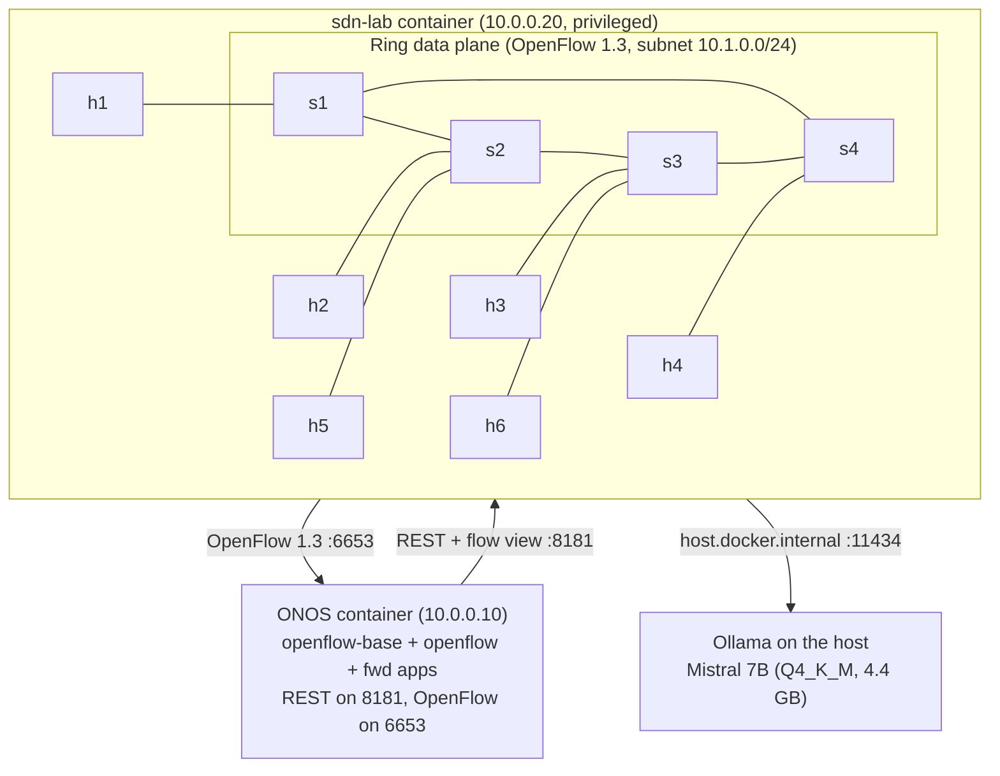

# Architecture: how the project works

This page explains what the components are, how a run produces evidence, how
the evidence becomes explanations, and how the explanations are scored. For
the commands, see [QUICKSTART.md](QUICKSTART.md) and [README.md](README.md).

## The testbed

Everything runs in Docker. Two containers on a private `sdn-net`
(10.0.0.0/24): the ONOS controller and a privileged "lab" container with
Mininet 2.3.0 and Open vSwitch on top of the host kernel's OVS datapath.
Mistral 7B runs outside the containers, on the host, served by Ollama; the
lab reaches it at `host.docker.internal:11434`.



The ring (s1-s2-s3-s4-s1) gives every pair of adjacent switches two disjoint
paths, which is what makes link and switch failures interesting instead of
instantly partitioning the network. Hosts h1..h6 hang off the switches
(10.1.0.1-6/24); ONOS reactive forwarding provides all-pairs connectivity
after the `openflow-base`, `openflow` and `fwd` applications are activated.

## The incident campaign

`project/run_experiment.py` orchestrates 30 runs: five families, six runs
each. Every run injects exactly one fault, keeps the injected fault separate
from the evidence (as `ground_truth.json`), and restores the network cleanly.

| Family | Injection | Restore |
|---|---|---|
| `link_failure` | one ring link administratively down (`configLinkStatus down`) | link back up |
| `switch_failure` | one OVS switch stopped | switch restarted, reconnects to ONOS |
| `congestion` | `tc netem` delay+loss on a host interface while a 40 s UDP iperf runs | netem qdisc removed |
| `host_disconnection` | host interface set down | interface back up |
| `normal` | nothing (negative control) | - |

Optional scenarios (behind `--optional`, not part of the 30-run campaign):
`forwarding_misconfig` (an OpenFlow drop rule for one victim host) and
`traffic_flood` (a 15 s rate-limited UDP burst).

Protocol detail that matters for reproducibility: ONOS is restarted before
every family and before every switch_failure run, so each run starts from a
clean controller state.

## The evidence timeline

Each run collects the same snapshots at five checkpoints: `baseline`
(healthy), then after injection at `post_inject_10s`, `post_inject_30s`,
`post_inject_50s`, and finally `recovery` after restore. At each checkpoint
`project/collect_evidence.py` grabs four kinds of telemetry:

- `rest_<phase>.json`: ONOS REST state (devices, links, hosts, flows),
- `ovs_<phase>.txt`: `ovs-vsctl show` plus per-switch flow and port dumps,
- `karaf_window.log`: the ONOS Karaf log since the previous checkpoint,
- `probes.json`: ping pair statistics and iperf throughput measurements.

That is what you find under `project/runs/<run_id>/raw/`. The preprocessing
step (`preprocess_logs.py`) reduces them to a structured
`incident_record.json`: the signal events a run produced, in machine-readable
form (typically 11-12 signals per run). This record is the pivot between
"what happened in the network" and everything the explainers and the rubric
do later.

## The pipeline

```mermaid
flowchart LR
    A["30-run campaign<br/>run_experiment.py"] --> B["raw telemetry per run<br/>collect_evidence.py"]
    B --> C["incident_record.json<br/>preprocess_logs.py"]
    C --> D1["baseline.json<br/>baseline_explain.py<br/>deterministic rules"
    C --> D2["mistral_raw.json<br/>mistral_explain.py<br/>prompt: Karaf log excerpts + ping summary"]
    C --> D3["mistral_structured.json<br/>mistral_explain.py<br/>prompt: the incident record JSON"]
    D1 --> E["evaluate.py<br/>evaluation_summary.csv"]
    D2 --> E
    D3 --> E
    E --> F["rubric_human_template.csv<br/>joint human step: usefulness, clarity 1-5"]
```

Two design decisions to notice:

1. **Fixed prompts.** The Mistral prompts are templates, frozen for
   repeatability: the same evidence always produces the same prompt. The only
   variance between machines is the model's own sampling.
2. **Three conditions, one interface.** Every explanation, human- or
   machine-generated, is written to the same JSON shape (category, observed
   events, likely cause, evidence cited, operator checks, uncertainty), so the
   evaluation treats them identically.

The `group11` launcher wraps all of this: `experiment` runs the whole diagram
from the testbed up; `analysis` starts from the recorded evidence in the
middle of the diagram. Both are resumable.

## The evaluation rubric

For each run and each condition, `project/evaluate.py` scores the explanation
against the ground truth, which was stored separately at injection time:

| Metric | Range | Meaning |
|---|---|---|
| `identification_correct` | 0/1 | did the explanation name the right incident family? Abstaining (`insufficient_evidence`) on a normal run counts as correct. |
| `grounding_0_2` | 0-2 | are the affected elements (from ground truth) actually named in the explanation? |
| `unsupported_assertions` | count | entities (switches, hosts, links) the explanation mentions that appear nowhere in the recorded evidence. |
| `usefulness_human_1_5`, `clarity_human_1_5` | 1-5 | filled jointly by humans in `rubric_human_template.csv`, then merged by re-running the evaluation. |
| `runtime` | ms | how long the explanation took. |

Reference results (project report, 30 runs):

| Condition | Identification | Avg grounding | Avg runtime |
|---|---|---|---|
| baseline (rules) | 26/30 (86.7%) | 0.93 | < 1 ms |
| mistral_raw | 25/30 (83.3%) | 0.60 | 242 s |
| mistral_structured | 24/30 (80.0%) | 0.53 | 453 s |

How these numbers behaved on other machines (identical raw conditions, one
sampling-level difference in structured, 10-15x faster Mistral calls on
Apple Metal) is documented in [README.md](README.md#reproduction-notes).

## Repository map

```
group11                 one-command launcher (all modes, platform detection)
QUICKSTART.md           fast path for new users
ARCHITECTURE.md         this file
README.md               full reference: modes, macOS, results, troubleshooting
Dockerfile              lab image: Ubuntu 20.04 + Mininet 2.3.0 + OVS + tooling
entrypoint.sh           lab container entrypoint (modules, OVS, sshd)
docker-compose.yml      ONOS + sdn-lab on sdn-net
project/
  README.md             per-script usage, environment variables, VM option
  topo_group11.py       the 4-switch / 6-host ring topology
  run_experiment.py     campaign orchestrator (injections below)
  collect_evidence.py   REST/OVS/Karaf/probe snapshots per phase
  preprocess_logs.py    raw evidence -> incident_record.json
  baseline_explain.py   rule-based explainer
  mistral_explain.py    Mistral 7B explainer (raw + structured prompts)
  evaluate.py           rubric + evaluation_summary.csv
  runs/                 recorded 30-run evidence, explanations, evaluation CSVs
```

## Why the container is privileged

Mininet creates real kernel network devices and Open vSwitch needs the
host kernel's OVS module: that requires a privileged container and is why
`experiment` needs a Linux host kernel with Open vSwitch available (stock
Ubuntu/Debian/Kali kernels have it; Docker Desktop on current macOS does
not, which is the reason `analysis` is the Mac workflow). The lab container
also mounts the Docker socket to capture the ONOS Karaf log via
`docker logs`. Both choices are scoped to the emulated lab; see the security
notes in [README.md](README.md#security-notes).
